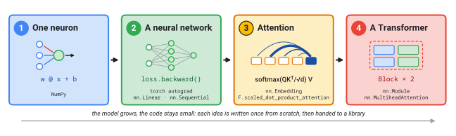

# From One Neuron to a Transformer (short workshop)

A concise, hands-on Jupyter notebook for the **GDG AI for Science** community. In about an hour, learners build one artificial neuron from scratch, grow it into a neural network, and finish with a small, readable Transformer that learns to write DNA reverse complements.

It's inspired by the talk [*Inside the Black Box: How AI Really Works*](../README.md) (same examples, same numbers) and taught in the style of [Software Carpentry](https://software-carpentry.org/) and the [CAITG AI Winter School](https://gdgaiforscience.github.io/CAITG-WinterSchool/). The 90-minute version is in [`../workshop/`](../workshop/).



* **Notebook:** [`neuron_to_transformer.ipynb`](neuron_to_transformer.ipynb). It's pre-executed, with the diagrams embedded, and runs top to bottom on a laptop CPU in under a minute.
* **Audience:** researchers and students with basic Python. No calculus needed: picture first, equation second.
* **Approach:** each idea is written from scratch once, then handed to a library (NumPy → PyTorch autograd → `nn.Module`). The model grows but the code stays short: about 150 visible lines (plus two folded plotting helpers), with the whole Transformer in 24.

## Schedule (60 minutes)

| Time | Part | Live code | Hands-on |
|:--|:--|:--|:--|
| 0:00 | Setup | imports, folded plotting helpers | run the first two cells |
| 0:05 | **1 · One neuron** | the talk's neuron (1.02 → 0.73); Fisher's irises; gradient descent in NumPy (94%) | 1.1 predict, then run · 1.2 slider playground · 1.3 *bonus:* Kepler's third law |
| 0:17 | **2 · A neural network** | a layer as a matrix; backprop by hand (−0.2115) = `loss.backward()`; moons with `nn.Sequential` | 2.1 remove the bend |
| 0:32 | **3 · Attention** | `nn.Embedding`; causal self-attention in six lines = `F.scaled_dot_product_attention` | 3.1 the temperature dial |
| 0:42 | **4 · A Transformer** | `Block` + `TinyGPT`; DNA reverse complement; generation; 100% on 1,000 new strands; the attention map | 4.1 temperature as a mutation rate · 4.2 remove positions · 4.3 *bonus:* `nn.TransformerEncoderLayer` |
| 0:57 | Wrap-up | the six equations of the talk, mapped to the code you wrote | |

Running short? Skip the bonus challenges (1.3 and 4.3) and do 3.1 as a live demo. Running long? Let learners try 4.2, which needs a retrain of 10 to 20 seconds.

## Running the notebook

* **Google Colab (no setup):** *File → Upload notebook*, choose `neuron_to_transformer.ipynb`, then *Runtime → Run all*. The diagrams are embedded in the notebook, so no other files are needed, and no GPU is needed either.
* **Local, with the `gdg` conda environment:**

  ```bash
  cd workshop-short
  /usr/local/google/home/butterworthnat/miniforge3/envs/gdg/bin/python -m pip install jupyterlab   # once
  /usr/local/google/home/butterworthnat/miniforge3/envs/gdg/bin/jupyter lab neuron_to_transformer.ipynb
  ```

  Any environment with `numpy`, `matplotlib`, `torch`, `scikit-learn` and `ipywidgets` works. VS Code opens the notebook directly.

## Folder layout

```text
workshop-short/
├── README.md                     this guide
├── neuron_to_transformer.ipynb   the workshop notebook (executed, diagrams embedded)
├── assets/                       diagrams as SVG + PNG (Google light palette, WCAG 2.2 AA text)
│   ├── roadmap.*                 the four parts and the library used in each
│   ├── neuron_and_layer.*        the talk's neuron (0.73) and a layer as one matrix multiply
│   ├── attention.*               "it" → trophy 51%: real Gemma 3 weights from ../data/attention.js
│   └── transformer.*             TinyGPT, labelled with the names used in the code
└── scripts/
    └── make_figures.py           redraws assets/ and refreshes the copies embedded in the notebook
```

To rebuild everything:

```bash
python workshop-short/scripts/make_figures.py
jupyter nbconvert --to notebook --execute --inplace workshop-short/neuron_to_transformer.ipynb
```

`make_figures.py` uses the Roboto fonts in [`../fonts/`](../fonts/). The notebook is the source of truth, so edit it directly in Jupyter. The diagram cells are tagged with `"figure"` metadata so that the script can swap in fresh images.

## Teaching notes

* **Live-code, don't scroll.** Every code cell is short enough to type. Type it, run it, then ask what the output means.
* **Sticky notes.** Learners show green when they reach each ✅ checkpoint (94% irises, curved moons, `tensor(1.)`) and red or yellow when they're stuck.
* **Misconceptions to bring out:**
  1. *"More layers always means more power."* Not without the bend: Challenge 2.1 collapses the network to a straight line.
  2. *"Attention is magic."* It's a weighted average with learned weights, in six lines (Part 3).
  3. *"It just memorised the DNA."* It scores 100% on 1,000 strands drawn from 16.7 million possibilities, and its attention map shows the rule it found.
  4. *"Transformers know word order."* Only through position embeddings (Challenge 4.2).
* **The numbers match the talk:** neuron 1.02 → 0.73; layer 0.73, 0.58, 0.57, 0.33; backprop −0.538 × 0.197 × 2 = −0.2115; iris neuron 94% (best possible line 97%); Kepler *w* = 1.498, diverging at η = 0.8; Gemma 3 "it" → trophy 51%.
* **Timing:** the Transformer trains in 10 to 20 seconds on a two-core CPU like free Colab's (11 seconds on two cores of a workstation). The slider playground needs a live kernel, so run its cell during the session.
